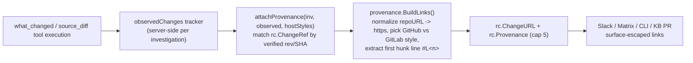

# Design — Clickable provenance anchors in cards & KB PRs

- **Date:** 2026-11-24
- **Status:** Approved (grilling complete)
- **Owner:** Smaine Kahlouch
- **Touches:** `internal/providers/providers.go`, `internal/provenance/` (new), `internal/investigate/{loop.go,tools.go,observedchanges.go}`, `internal/notify/{format.go,slack.go,matrix.go}`, `internal/curator/curator.go`, `internal/app/investigate.go`

## Problem

When RunLore traces an incident to a GitOps revision change (`what_changed`), a source-repo release diff (`source_diff`), or an existing knowledge-base entry (`kb_search` / instant recall), the card and KB PR render bare monospace identifiers (`aaa111..bbb222`) or entry titles without deep links. An on-call engineer woken at 03:00 still has to open GitHub/GitLab manually, find the repository, navigate to the commit range, hunt for the changed file and line number, or scroll through a long KB entry to find the resolution.

Meanwhile, RunLore **already observes** the exact `SourceRef{RepoURL, Path}`, `FromRev`, `ToRev`, `Diff.Files` (with unified diff hunks), and KB entry path/sections server-side during tool execution. Turning those verified server-side facts into clickable anchors eliminates manual lookup while keeping untrusted model text strictly non-executable.

## Decisions (locked during grilling)

| # | Decision | Choice | Rationale |
|---|---|---|---|
| **Q1** | Scope & trust model | **100% server-derived Git & KB provenance links** (compare/commit links for observed `what_changed`/`source_diff` changes, up to 5 changed-file permalinks `path#L<n>`, and KB entry + `#resolution` heading anchors) — **never trusting model-authored URLs** | Mirrors `observedresources.go`'s trust invariant: a prompt-injected log line cannot inject a phishing URL into Slack, Matrix, or a KB PR. Only revisions, files, and entries actually observed by RunLore's own tools receive links. |
| **Q2** | Forge URL resolution | **Deterministic host→style mapping with zero new config keys**: `github.com` → GitHub, `gitlab.com` → GitLab, self-hosted host matching configured `forge.git_host`/`forge.gitlab.url` → configured `forge.provider` style, unknown custom host → fail closed (omit link). Normalize `git@`/`ssh://` to `https://`, strip `.git`, enforce `https://` scheme only | Covers GitHub, GitLab, GHE, and self-hosted GitLab without config sprawl, and never fabricates broken 404 URLs for unrecognized internal Git hosts. |
| **Q3** | Card layout & density | **Main Slack/Matrix cards stay compact** (zero added lines): hyperlink `What changed:` directly and hyperlink `MatchedKB` to `#resolution` when present. **Detail views** (Slack thread reply, Matrix detail, CLI `Format`, KB PR body) list up to 5 changed-file permalinks (`path#L<n>`) | Preserves the scannable verdict-first main card while putting one-click file/hunk verification directly in the detail thread and KB PR. |

## Non-goals

- **Model-authored URLs.** Any URL emitted by the LLM inside `Summary`, `ChangeRef`, or `Evidence` remains escaped plain text.
- **External observability UI links (Grafana/Prometheus Explore).** Out of scope; requires vendor-specific query-UI URL templates and external base URLs RunLore does not otherwise need.
- **New config keys for arbitrary host-style overrides.** Reuses existing `forge.provider`, `forge.git_host`, and `forge.gitlab.url`.

## Data contract (`internal/providers/providers.go`)

```go
// ProvenanceLink is a server-constructed, verified HTTPS link pointing to the
// exact change, file hunk, or KB section backing a finding. Never populated
// from model output.
type ProvenanceLink struct {
	Label string `json:"label"`          // short human label, e.g. "aaa111..bbb222" or "apps/harbor/values.yaml#L42"
	URL   string `json:"url"`            // validated https:// permalink
	Kind  string `json:"kind,omitempty"` // "compare" | "commit" | "file" | "kb"
}
```

- On `providers.Hypothesis`:
  - `ChangeURL string` (`json:"change_url,omitempty"`): verified compare/commit HTTPS permalink for `ChangeRef` (empty when unobserved or unknown host).
  - `Provenance []ProvenanceLink` (`json:"provenance,omitempty"`): up to 5 verified changed-file permalinks (`path#L<n>`) associated with `ChangeRef`.
- On `providers.MatchedKB`:
  - `SectionAnchor string` (`json:"section_anchor,omitempty"`): e.g. `"#resolution"` when the matched entry contains a `## Resolution` heading (already parseable via `internal/catalog/section.go`), appended onto the canonical KB entry URL when rendering.

## Server-side provenance pipeline



### 1. URL builder (`internal/provenance`)

- **`ForgeStyle`**: `StyleGitHub` (`"github"`) or `StyleGitLab` (`"gitlab"`).
- **`HostStyles`**: `map[string]ForgeStyle` seeded with `github.com → StyleGitHub`, `gitlab.com → StyleGitLab`, plus the host from configured `forge.git_host` / `forge.gitlab.url` mapped to `forge.provider`.
- **`NormalizeRepoHTTPS(rawURL string, styles HostStyles) (baseHTTPS string, style ForgeStyle, ok bool)`**:
  - Handles `https://host/org/repo(.git)`, `ssh://git@host/org/repo(.git)`, and SCP-style `git@host:org/repo(.git)`.
  - Rejects `http://` (cleartext), `file://`, userinfo in output URL, query/fragment, control chars, whitespace, or path traversal (`..`).
  - Looks up lowercase hostname in `styles`; returns `ok=false` on unknown host (fail closed).
- **URL templates (both validate clean SHA/ref tokens `[A-Za-z0-9._/-]+` and percent-escape path segments):**
  - GitHub:
    - Compare: `<base>/compare/<from>...<to>`
    - Commit: `<base>/commit/<sha>`
    - File (with optional `#L<n>`): `<base>/blob/<to>/<path>#L<n>`
  - GitLab:
    - Compare: `<base>/-/compare/<from>...<to>`
    - Commit: `<base>/-/commit/<sha>`
    - File (with optional `#L<n>`): `<base>/-/blob/<to>/<path>#L<n>`
- **Hunk line extraction (`FirstAddedLine(unifiedPatch string) int`):**
  - Parses the first `@@ -oldStart[,oldCount] +newStart[,newCount] @@` header in `FileDiff.Patch` and returns `newStart` when `> 0` (omitting `#L` if absent, e.g., deleted/binary files).

### 2. Observed-change tracking (`internal/investigate/observedchanges.go`)

- Mirrors `observedresources.go`: each investigation creates a per-run `observedChanges` recorder.
- When `what_changed` or `source_diff` returns a `Change` + `Diff`, the server records `{RepoURL, FromRev, ToRev, Files: [{Path, FirstLine}]}` (zero extra Git/network calls — uses the `Diff` already materialized!).
- After the loop (and before `redactInvestigation` / delivery), `attachProvenance`:
  - Matches each `rc.ChangeRef` against observed changes by checking whether `rc.ChangeRef` contains an observed `ToRev` (or its ≥7-char short SHA prefix) or `FromRev..ToRev`.
  - If matched and `NormalizeRepoHTTPS` succeeds:
    - Sets `rc.ChangeURL` to the compare URL (when both `FromRev` and `ToRev` exist and differ) or commit URL (single commit).
    - Sets `rc.Provenance` to up to 5 changed-file permalinks (preferring files whose path is mentioned in `rc.ChangeRef` or `rc.Evidence`, then preserving diff order).
  - Never touches `rc.ChangeURL` or `rc.Provenance` if `rc.ChangeRef` is unobserved (fail closed).
- For `inv.MatchedKB`: when `catalog.Entry` has a non-empty `## Resolution` section (`catalog.HasSection(body, "Resolution")`), stamp `SectionAnchor: "#resolution"` onto `MatchedKB` so entry links jump straight to the fix.

### 3. Safe per-surface rendering

| Surface | `ChangeRef` + `ChangeURL` | Changed-file `Provenance` (up to 5) | `MatchedKB` |
|---|---|---|---|
| **Slack main card** | `<url\|escapeMrkdwn(ChangeRef)>` in existing `What changed:` line | *(omitted on main card to preserve density)* | `<entryURL#resolution\|escapeMrkdwn(title)>` |
| **Slack thread detail** | `<url\|escapeMrkdwn(ChangeRef)>` | Bulleted `<url\|escapeMrkdwn(label)>` under `Provenance:` | *(same)* |
| **Matrix card / detail** | `<a href="htmlEsc(url)">htmlEsc(ChangeRef)</a>` | Bulleted `<a href="...">` list in detail section | `<a href="...#resolution">` |
| **CLI (`notify.Format`)** | `What changed: <ChangeRef> (<ChangeURL>)` | Indented `↳ <label>: <url>` lines | `Matches known runbook: <title> (<url>#resolution)` |
| **KB PR (`internal/curator`)** | `[<ChangeRef>](<url>)` | Markdown link list under `### Provenance` | *(n/a)* |

- **Safe link helper per renderer:** validate `strings.HasPrefix(u, "https://")` and reject any `|`, `<`, `>`, whitespace, or control chars before emitting a clickable link (otherwise fall back to escaped plain text).

## Verification plan

- Unit tests in `internal/provenance/provenance_test.go`:
  - GitHub (`github.com`), GitLab (`gitlab.com`), self-hosted GHE, self-hosted GitLab, SSH `git@` & `ssh://`, `.git` suffix stripping, unknown host fail-closed, malicious/non-HTTPS URLs rejected.
  - `FirstAddedLine` across standard hunks, single-line hunks (`+1`), deleted files (`+0,0`), binary diffs.
  - File path percent-encoding (spaces, `#`, parentheses).
- Unit tests in `internal/investigate/observedchanges_test.go`:
  - Matches short/full SHA and `from..to` ranges; ignores hallucinated/unobserved SHAs; prioritizes evidence-referenced files and caps at 5.
- Unit tests in `internal/notify/` and `internal/curator/`:
  - Slack mrkdwn escaping (label containing `|`/`>`/`<` cannot break link syntax), Matrix HTML escaping, CLI formatting, KB PR markdown, golden tests unchanged when `ChangeURL == ""`.
- Full quality gate: `go build ./... && go vet ./... && go test ./... && gofmt -l . && hack/lint.sh`.
