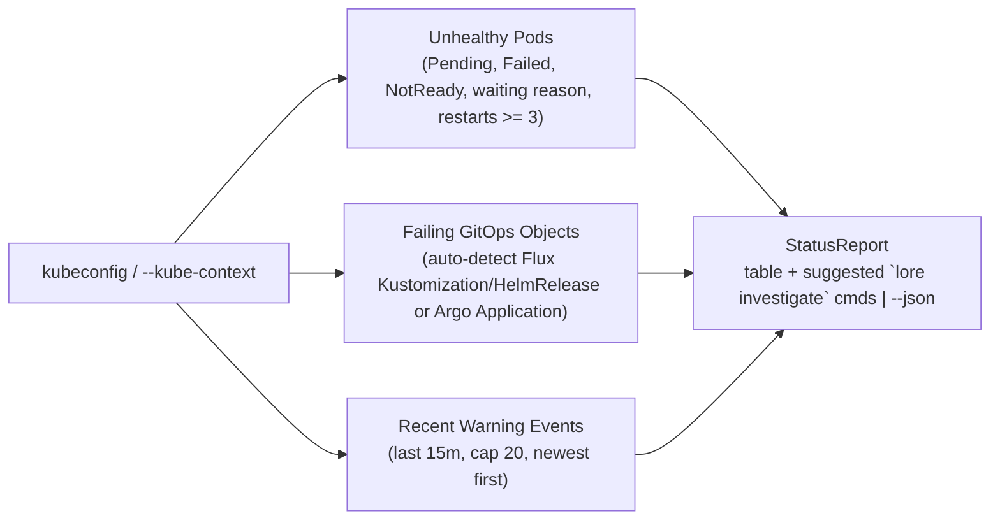

# Design — Zero-config Day-0 CLI ergonomics (`lore investigate` + `lore status`)

- **Date:** 2026-11-24
- **Status:** Implemented (PR #631, merged 2026-11-24)
- **Owner:** Smaine Kahlouch
- **Touches:** `cmd/lore/main.go`, `internal/app/{investigate_cmd.go,investigate_config.go,kube.go,status_cmd.go}`, `internal/providers/providers.go`, `internal/providers/gitops/{flux,argocd}/`, `internal/investigate/loop.go`, `website/content/docs/reference/cli.md`, `README.md`

## Problem

RunLore's local adoption funnel currently jumps sharply from offline replay (`hack/demo.sh`) to full Helm + YAML config + webhooks. `lore investigate` already reads ambient kubeconfig and falls back to environment variables when `./runlore.yaml` is absent, yet four pieces of day-0 friction remain:

1. **Incomplete environment auto-detection.** `configFromEnv()` recognizes `OPENAI_BASE_URL` and `ANTHROPIC_API_KEY`, but fails on `GEMINI_API_KEY` and bare `OPENAI_API_KEY` (without `OPENAI_BASE_URL`), and has no `--provider` or `--effort` override flags.
2. **Awkward workload targeting.** Callers must supply `--alert` and/or `--message`, cannot pass a positional target (`apps/checkout-api`), and `req.Workload` only ever populates `Namespace` — never `Name` or `Kind`, starving workload-scoped prompts and recall matching.
3. **No zero-LLM live cluster snapshot.** An engineer sitting at a terminal with a broken cluster has no instant way to ask "what is unhealthy right now, and what should I investigate first?" without spending LLM tokens.
4. **Silent waits and missing multi-cluster / scripting flags.** `lore investigate` offers no `--kube-context`, no `--json`, and no concise live stderr progress trace while the ReAct loop runs.

## Decisions (locked during grilling)

| # | Decision | Choice | Rationale |
|---|---|---|---|
| **Q1** | Command surface | **Extend `lore investigate` in place + add zero-LLM `lore status`** | Keeps one investigation verb (no split between `diagnose` and `investigate`) while giving terminal users a fast, free cluster triage entry point that prints ready-to-run `lore investigate` commands. |
| **Q2** | Env auto-detection & precedence | **Deterministic order when no config file & no `--provider`: `OPENAI_BASE_URL` → `ANTHROPIC_API_KEY` → `GEMINI_API_KEY` (default `gemini-4-neon`) → bare `OPENAI_API_KEY` (default `https://api.openai.com/v1`)**; per-provider model overrides (`ANTHROPIC_MODEL`, `GEMINI_MODEL`, `OPENAI_MODEL`), explicit `--provider`/`--model`/`--effort`, plus one stderr line naming the chosen provider/model | Preserves local/private endpoint priority (`OPENAI_BASE_URL` first), unblocks Gemini and direct OpenAI users with zero YAML, and eliminates silent ambiguity on multi-key laptops via explicit stderr reporting and `--provider`. |
| **Q3** | Positional target resolution | **Parse `<ns>/<name>` or `<kind>/<ns>/<name>` directly into `Workload{Kind, Namespace, Name}`** (via existing `parseInterleaved` so flags may follow the positional arg), with no pre-loop API probing; synthesize a title when `--alert` is omitted | Avoids slow/fragile pre-loop API guesses; lets the loop's existing `pod_status`/`resource_spec`/`what_changed` tools inspect live state honestly. |
| **Q4** | `lore status` signals & exit code | **Unhealthy pods + failing GitOps objects (Flux/Argo auto-detected) + bounded recent Warning events (15m)**; prints compact table + ready-to-run `lore investigate <target>` suggestions (or `--json`); exits `0` by default (`1` on kube/API error, or when `--exit-code` sees unhealthy items) | Gives maximum triage clarity at zero LLM cost while staying ergonomic in interactive shells and scriptable in CI/cron via `--exit-code` and `--json`. |
| **Q5** | Live terminal progress | **Compact one-line tool progress on stderr by default** during `lore investigate` (e.g. `→ what_changed(apps)`); suppress with `--quiet` or `--json`; stdout remains strictly the final verdict (text or JSON) | Makes 20–60s live runs legible like `lore demo` without polluting piped stdout or structured JSON output. |

## Non-goals

- **Interactive multi-turn chat REPL in the terminal.** One-shot investigation + JSON output is sufficient; interactive chat already lives in Slack/Matrix threads.
- **Cluster mutation from `lore status`.** Strictly read-only, zero-LLM.
- **Changing `lore serve` config resolution.** Env auto-detection and `--kube-context` apply only to CLI commands (`investigate`, `status`), never to in-cluster `serve`.

## Detailed design

### 1. `lore investigate` target & flag contract

```text
lore investigate [<ns>/<name> | <kind>/<ns>/<name>]
  [--alert <name>] [--namespace <ns>] [--message <text>]
  [--config <path>] [--provider openai|anthropic|gemini] [--model <name>]
  [--base-url <url>] [--effort <level>]
  [--metrics-url <url>] [--logs-url <url>]
  [--kube-context <name>] [--json] [--quiet]
```

- Uses `parseInterleaved(fs, args)` (already in `internal/app/kb_cmd.go`) so `lore investigate apps/checkout-api --model gemini-4-carbon --json` parses cleanly.
- **Target parsing (`parseTarget`):**
  - Accepts at most 1 positional argument (reject 2+ with a usage error).
  - `a/b` → `Workload{Namespace: a, Name: b}`.
  - `a/b/c` → `Workload{Kind: a, Namespace: b, Name: c}`.
  - Any empty segment or 4+ segments → clear validation error.
  - If `--namespace` is also passed alongside a positional target and differs from the target's namespace → fail fast with a clear conflict error.
  - At least one of `<target>`, `--alert`, or `--message` must be supplied.
  - Default title when `--alert` is empty: `"Investigate <target>"` (when a target is given), else `"on-demand investigation"`.
- **Environment auto-detection (`configFromEnv(providerOverride string)`):**
  - Precedence when `providerOverride == ""`:
    1. `OPENAI_BASE_URL` → `provider: ""` (OpenAI-compatible), `base_url: $OPENAI_BASE_URL`, `model: cmp.Or($OPENAI_MODEL, "gpt-4o-mini")`, optional `api_key_env: OPENAI_API_KEY`.
    2. `ANTHROPIC_API_KEY` → `provider: "anthropic"`, `model: cmp.Or($ANTHROPIC_MODEL, "claude-sonnet-5")`, `api_key_env: ANTHROPIC_API_KEY`.
    3. `GEMINI_API_KEY` → `provider: "gemini"`, `model: cmp.Or($GEMINI_MODEL, "gemini-4-neon")`, `api_key_env: GEMINI_API_KEY`.
    4. `OPENAI_API_KEY` → `provider: "openai"`, `base_url: "https://api.openai.com/v1"`, `model: cmp.Or($OPENAI_MODEL, "gpt-4o-mini")`, `api_key_env: OPENAI_API_KEY`.
  - When `--provider` is explicitly given, select that provider's branch directly (and return a clear error naming the missing env var if its key/URL is unset).
  - Apply `--model`, `--base-url`, `--effort`, `--metrics-url`, `--logs-url`, then run `cfg.Validate()` **after** flag overrides (so an invalid `--effort` or cleartext `--base-url` fails fast at startup).
  - Print one stderr line when not `--quiet` / `--json`: `using <provider>/<model> (source: <env|config>)`.
- **Live stderr progress:**
  - Add an optional `OnToolCall func(step int, call providers.ToolCall)` hook on `investigate.LoopInvestigator` (nil-safe, zero overhead when unset).
  - In `RunInvestigate`, when `!quiet && !jsonOut`, emit `→ <tool>(<brief-arg>)` to `os.Stderr` (redacting any secrets in the brief arg preview).
- **JSON output (`--json`):**
  - Marshal the final redacted `*result` (`providers.Investigation`) to indented JSON on `os.Stdout`.

### 2. `lore status` — zero-LLM deterministic cluster triage

```text
lore status [--namespace <ns>] [--kube-context <name>] [--json] [--exit-code]
```



- **Kubeconfig context (`internal/app/kube.go`):**
  - Introduce `RestConfigForContext(kubeContext string) (*rest.Config, error)`: when `kubeContext == ""`, preserves `RestConfig()` exactly (`InClusterConfig` → default kubeconfig); when non-empty, loads local kubeconfig with `clientcmd.ConfigOverrides{CurrentContext: kubeContext}`.
  - Wire `kubeContext` through `KubeClientset`, `GitOpsFromKube`, and `BuildResourceSpecReader` via a small helper or `WithKubeContext` path so both `investigate` and `status` honor `--kube-context`.
- **GitOps snapshot:**
  - Add an optional interface `providers.GitOpsFailureLister` (`ListFailures(ctx context.Context, namespace string) ([]providers.FailureEvent, error)`) implemented by both Flux (`Kustomization` + `HelmRelease` where `Ready=False`) and Argo CD (`Application` where `Health=Degraded` or `Sync=OutOfSync`). Reuses existing CRD parsing logic in `internal/providers/gitops/{flux,argocd}` without starting watch informers.
- **Pods & Warning events:**
  - Use `KubeClientset`: list pods (scoped to `--namespace` if set, else all namespaces), filter unhealthy ones (phase `Failed`/`Pending`, container waiting reason like `CrashLoopBackOff`/`ImagePullBackOff`/`CreateContainerConfigError`, not Ready past startup, or restart count ≥ 3), sorted deterministically.
  - List `Type=Warning` events within the last 15 minutes (capped at 20, newest first).
- **Output & exit code:**
  - Human output: three compact sections (`GitOps failures`, `Unhealthy pods`, `Recent warning events`) followed by `Next step:` printing concrete `lore investigate <kind>/<ns>/<name>` commands (capped at top 5). When everything is healthy, prints `Cluster healthy (0 GitOps failures, 0 unhealthy pods, 0 recent warning events).`.
  - `--json`: prints structured `StatusReport` JSON to stdout.
  - Exit code: `0` on success; `1` on kube/API error; `1` when `--exit-code` is set and `len(GitOpsFailures)+len(UnhealthyPods) > 0` (note: warning events alone do not fail `--exit-code` unless you have unhealthy pods or failing GitOps objects, avoiding flaky exits on transient event noise).

## Verification plan

- Unit tests for `parseTarget`, `configFromEnv` (all 4 env precedence tiers, `--provider` override, `--effort` validation after override, cleartext URL rejection), `OnToolCall` progress callback, and `--json` output.
- Unit tests for `lore status` using `fake.NewSimpleClientset` + fake `GitOpsFailureLister`: healthy cluster, unhealthy pods + Flux/Argo failures + recent/stale Warning event filtering, `--exit-code` behavior, `--json` output, and suggested `lore investigate` commands.
- Unit tests for `RestConfigForContext` (unknown context returns a clear error).
- Docs updated in `website/content/docs/reference/cli.md` and `cmd/lore/main.go` usage.
- Full quality gate: `go build ./... && go vet ./... && go test ./... && gofmt -l . && hack/lint.sh`.
