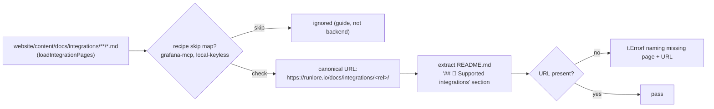

# Design — Public docs freshness (`v0.20.0`) & `README.md` `docsguard`

- **Date:** 2026-11-24
- **Status:** Implemented (PR #625, merged 2026-11-24)
- **Owner:** Smaine Kahlouch
- **Touches:** `internal/docsguard/integration_pages_test.go`, `README.md`, `ROADMAP.md`, `website/content/docs/concepts/design.md`, `website/content/docs/integrations/_index.md`

## Problem

While `internal/docsguard` already pins `website/content/docs/integrations/*.md` against runtime registries (`TestIntegrationPagesMatchRegistries`) and against `website/content/docs/integrations/_index.md` (`TestIntegrationPagesAreLinkedFromTheIndex`), three top-level entry documents have silently drifted behind `v0.20.0`:

1. **`README.md` undersells shipped capabilities.** Its `## Supported integrations` table omits **Loki**, **Elasticsearch**, **OpenSearch**, **GitLab**, **Grafana Alerting**, **custom webhook** sources, and **templated** notifiers, and makes no mention of `v0.15–v0.20` capabilities (thread Q&A / thread-to-KB writeback, `threatcheck` injection screening, `decision_model`, KB-over-HTTP / `lore kb resolve`, and the optional external `factory` loop).
2. **`ROADMAP.md` lists already-shipped work as future work.** Four items under `## Next` and `## Later` are already in the tree: templated webhook source (`internal/source/custom`), templated notifier (`internal/notify/templated`), persisted vector cache (`internal/catalog/veccache.go`), and hot-path benchmarks (12 `Benchmark*` functions).
3. **`website/content/docs/concepts/design.md` duplicates and drifts from canonical docs.** §7 maintains a third hand-copied provider table (still listing Loki and GitLab under "Later"), and §13 maintains a stale ASCII package tree missing ~20 packages already documented in `AGENTS.md`.
4. **Factual typo in `website/content/docs/integrations/_index.md:45`.** The Gemini card claims "over the OpenAI-compatible endpoint" even though `internal/model/gemini` speaks the native `streamGenerateContent` API.

## Decisions (locked during grilling)

| # | Decision | Choice | Rationale |
|---|---|---|---|
| **Q1** | Single source of truth for integrations | **Keep and guard `README.md`'s summary table; replace `design.md` §7's provider table with a link to `integrations/_index.md`** | Eliminates the third copy while keeping GitHub's landing page self-contained and CI-verified. |
| **Q2** | `README.md` scope for `v0.15–v0.20` features | **Update the full integrations table + add concise rows/links for thread Q&A/KB-writeback, `threatcheck`, `decision_model`, KB-over-HTTP, and `factory`** without bloating the hero flow; fix the stale Gemini subtitle in `integrations/_index.md` | Keeps `README.md` crisp for first-time readers while accurately reflecting shipped capabilities. |
| **Q3** | `docsguard` matching mechanism for `README.md` | **Canonical `https://runlore.io/docs/integrations/<path>/` URL check inside `README.md`'s `## Supported integrations` section** | Zero coupling to display-name wording (prose edits never break CI), makes every integration in `README.md` clickable, and directly reuses the page paths `loadIntegrationPages` already discovers. |
| **Q4** | `ROADMAP.md` cleanup | **Remove the 4 already-shipped items and keep `ROADMAP.md` strictly to public/issue-tracked items** per its own contract | Preserves `ROADMAP.md`'s honesty guarantee ("Everything below is either already public in the repo or tracked as an open issue"). |
| **Q5** | `design.md` §13 repo layout | **Replace §13's stale ASCII package tree with a link to `AGENTS.md`'s Layout section** | Same deduplication principle as Q1: `AGENTS.md` already carries the maintained, grouped package map. |
| **Q6** | Breadth of the `README.md` guard | **Guard every `integration: {kind, id}` page under `website/content/docs/integrations/` except explicit guide/recipe pages (`grafana-mcp`, `local-keyless`)** | Covers non-registry integrations too (`gitlab`, `aws-cloud`, `gcp-cloud`, network providers, LLMs), preventing the exact GitLab omission that happened before. |

## Non-goals

- **Auto-generating `README.md` via codegen.** Hand-authored prose with a URL-presence guard preserves editorial quality while catching omissions.
- **Guarding `ROADMAP.md` programmatically.** Roadmap status is editorial and tied to GitHub issue state.
- **Rewriting `website/content/docs/integrations/*` pages.** Those pages are already up to date and guarded against registries; only `_index.md:45`'s factual subtitle error is fixed here.

## Guard design (`internal/docsguard`)

Add `TestReadmeListsAllIntegrationPages` in `internal/docsguard/integration_pages_test.go`:



- **Section scoping:** Extract only the slice of `README.md` between the `## ` heading containing `Supported integrations` and the next `\n## ` heading (fail-loud if the heading is missing — guards the guard). Scoping to the section prevents a stray link in the footer from masking a missing table row.
- **Explicit skip map:**
  ```go
  // readmeSkippedIntegrationIDs lists integration pages that are worked recipes or
  // deployment-mode guides rather than distinct backends in README.md's table.
  var readmeSkippedIntegrationIDs = map[string]bool{
      "grafana-mcp":   true, // worked MCP recipe; MCP itself is listed
      "local-keyless": true, // deployment guide for OpenAI-compatible; covered by openai-compatible
  }
  ```
- **Stale-skip guard:** Assert every key in `readmeSkippedIntegrationIDs` actually matched a page during the walk, so renaming/deleting a recipe page cannot leave a dead skip entry behind.
- **Zero-check guard:** Assert `checked > 0` so a directory restructure cannot make the test vacuously pass.

## Document changes

1. **`README.md`:**
   - Update `## 🔌 Supported integrations` so every non-skipped integration links to `https://runlore.io/docs/integrations/<rel>/`:
     - **Logs:** VictoriaLogs · Loki · Elasticsearch · OpenSearch
     - **Triggers:** Alertmanager · GitOps failures · PagerDuty · Grafana Alerting · Custom webhook
     - **Notifiers:** Slack (threaded summary, feedback buttons, silence, thread Q&A & reply-to-KB) · Matrix (reactions, silence, thread Q&A & reply-to-KB) · Webhook · Templated
     - **Knowledge base (git forge):** GitHub (App auth) · GitLab (access token)
     - **Cloud / Network / Metrics / Kubernetes / LLM / Source repos / MCP:** all linked to their canonical integration pages.
     - Add concise rows for **Decision model** (optional System One rerank/dedup) and **Remediation handoff** (optional external factory client + post-soak verification), plus a brief note on `threatcheck` and KB-over-HTTP / `lore kb resolve` in the Learning loop section (linking to `learning-loop/` and `reviewing-knowledge/`).
   - Refresh `## Project status & stability` to include Loki/ES/OpenSearch, GitLab, Grafana/custom sources, and templated notifiers accurately.
2. **`ROADMAP.md`:**
   - Remove the 4 shipped items from `## Next` and `## Later`: templated webhook source, templated notifier, persisted vector cache + incremental indexing, and hot-path benchmarks.
   - Retain all genuinely open items (`#392` until Item 1 ships, `#391`, `#394`, `#362`, graduating hybrid recall, multi-KB federation, frozen `auto` rung).
3. **`website/content/docs/concepts/design.md`:**
   - §7: Keep the provider abstraction narrative, GitOps parity table, and cloud-identity notes; replace the stale hand-copied provider matrix with a direct `relref` link to `/docs/integrations/_index.md`.
   - §13: Replace the stale ASCII directory tree with a short note linking to `AGENTS.md` (on GitHub) for the live package layout.
4. **`website/content/docs/integrations/_index.md`:**
   - Fix line 45 (`llm/gemini/` subtitle): replace `"Google's models over the OpenAI-compatible endpoint"` with `"Google's Gemini models over the native streamGenerateContent API"`.

## Verification plan

- TDD: write `TestReadmeListsAllIntegrationPages` first and watch it fail on current `README.md` (listing Loki, Elasticsearch, OpenSearch, GitLab, Grafana, custom-webhook, templated, etc.).
- Apply doc updates and re-run `go test -v ./internal/docsguard/...`.
- Run full quality gate: `go build ./... && go vet ./... && go test ./... && gofmt -l . && hack/lint.sh`.
