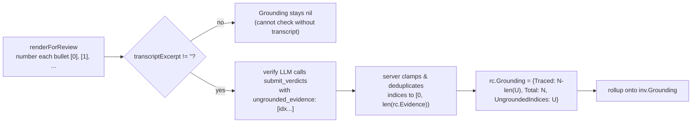

# Design — Splitting scalar confidence into Evidence Grounding + Causal Confidence

- **Date:** 2026-11-24
- **Status:** Implemented (PR #630, merged 2026-11-24)
- **Owner:** Smaine Kahlouch
- **Touches:** `internal/providers/providers.go`, `internal/investigate/{verify.go,verify_test.go,loop.go}`, `internal/notify/{format.go,slack.go,matrix.go,card_golden_test.go}`, `internal/curator/curator.go`, `internal/eval/{case.go,score.go,replay_report.go,compare_run.go,compare_report.go}`, `internal/telemetry/{metrics.go,setup.go}`, `website/content/docs/operations/observability.md`, `deploy/observability/`

## Problem

RunLore's verdict card currently compresses two distinct epistemic signals into a single scalar `Confidence` percentage (e.g. `80%`):

1. **Causal confidence** — how strongly the evidence proves causation rather than mere temporal correlation.
2. **Evidence grounding** — how many of the model's cited evidence bullets actually trace back to real tool output gathered during the investigation (versus unsupported or paraphrased claims).

Today [verify.go](file:///home/smana/Sources/runlore/internal/investigate/verify.go) already instructs the adversarial verifier to evaluate **both** properties against the bounded tool transcript, then throws away the grounding breakdown and outputs only a single `confidence` float. As a result, an on-call engineer reading `Medium confidence (55%)` cannot tell whether the telemetry was incomplete/ungrounded or whether all telemetry was solid while causality remained ambiguous.

## Decisions (locked during grilling)

| # | Decision | Choice | Rationale |
|---|---|---|---|
| **Q1** | Measurement mechanism | **Extend the existing verify pass (`submit_verdicts`) at zero extra LLM cost**: number cited evidence items (`[0]`, `[1]`, …) in `renderForReview` and accept optional `ungrounded_evidence` indices per verdict, validated/clamped server-side against `len(rc.Evidence)` | Adds zero extra LLM calls or latency, evaluates semantic tracing (so accurate paraphrases of log lines still count as grounded), and produces per-bullet precision without trusting model-invented counts. |
| **Q2** | Downstream gates | **Advisory visibility first** — preserve existing `inv.Confidence` semantics for `curator.MeetsBar`, `action.Policy`, and `eval.Score` `Pass` | Avoids premature hard gates before real eval data calibrates false-negative rates; `inv.Confidence` remains the monotonic causal confidence. |
| **Q3** | Card, CLI & PR presentation | **Inline indicator beside confidence when measured** (`High confidence (80%) · 3/3 evidence traced` or `2/3 evidence traced — 1 unverified`) + **`(unverified)` tag on individual ungrounded bullets** in CLI output, Slack thread detail, Matrix detail, and KB PR drafts; omit cleanly when unmeasured | Gives immediate scannability on the main card and pinpoints the exact questionable bullet in detail views without inventing fake `0/0` noise when verify didn't run or had no transcript. |
| **Q4** | Eval & observability wiring | **Surface grounding in `eval.Result`, replay reports, and `lore eval --compare`** (plus optional `min_grounding` per case, default `0`) and **emit Prometheus histogram `runlore_investigation_grounding_ratio`**; omit grounding whenever no tool transcript was available to check against | Makes groundedness measurable across model comparisons and production fleets while preventing unconfirmed recalls (empty transcript) from being falsely scored `0/N`. |

## Non-goals

- **Gating curation or actions on grounding right now.** Deferred until `lore eval` accumulates empirical baseline data.
- **Adding a second verifier LLM call.** Grounding rides on the existing `verifyFindings` completion.
- **Deterministic lexical-only verification.** Paraphrased metrics/diffs would trigger unacceptable false negatives without semantic judgment.

## Data contract (`internal/providers/providers.go`)

```go
// EvidenceGrounding records how many cited evidence bullets traced back to actual
// tool results during the adversarial verify pass. A nil pointer (or Total == 0)
// means grounding was not measured (verify skipped, failed, or no tool transcript
// was available to check against).
type EvidenceGrounding struct {
	Traced            int   `json:"traced,omitempty"`
	Total             int   `json:"total,omitempty"`
	UngroundedIndices []int `json:"ungrounded_indices,omitempty"` // sorted, unique 0-based indices into Hypothesis.Evidence
}

// Ratio returns Traced / Total in [0, 1], or 0 when Total <= 0.
func (g *EvidenceGrounding) Ratio() float64
```

- Add `Grounding *EvidenceGrounding` (`json:"grounding,omitempty"`) to both `providers.Hypothesis` and `providers.Investigation`.
- On `Investigation`, `Grounding` is the server-computed rollup across all surviving `RootCauses` that carried a non-nil `Grounding`: `Traced = sum(rc.Grounding.Traced)`, `Total = sum(rc.Grounding.Total)` (with `UngroundedIndices` omitted on the rolled-up struct since indices are per-hypothesis). If `Total == 0`, `Investigation.Grounding` stays `nil`.

## Verify pass mechanics (`internal/investigate/verify.go`)



1. **`renderForReview`:** Change evidence rendering from bare `- <e>` to numbered `[0] <e>`, `[1] <e>`, … so the reviewer can reference bullets unambiguously by index.
2. **`submitVerdictsSpec` & `verdict`:** Add optional property `ungrounded_evidence: {"type": "array", "items": {"type": "integer"}}` to each verdict item (not in `required`, so models that omit it when all evidence is grounded — or older mock fixtures — work unchanged).
3. **`verifyPrompt`:** Instruct the reviewer: for each kept/downgraded root cause, list in `ungrounded_evidence` the 0-based indices of any cited evidence items that do not trace to the tool transcript excerpt (empty array when all cited items trace).
4. **Server-side validation in `applyVerdicts`:**
   - Guard: only populate `rc.Grounding` when `hasTranscript` (`transcriptExcerpt(transcript) != ""`), `ok` (the reviewer returned a recognized verdict for index `i`), and `len(rc.Evidence) > 0`.
   - Deduplicate, sort, and clamp `v.UngroundedEvidence` to `[0, len(rc.Evidence))`; out-of-range indices are silently discarded (never let a hallucinated index push `Traced` negative).
   - `Traced = len(rc.Evidence) - len(ungrounded)`.
   - Roll up surviving `RootCauses` into `inv.Grounding`.
   - Rejected root causes move to `RuledOut` as before and do not contribute to `inv.Grounding`.
5. **Unmeasured safety:** When verify fails (`verified == false`), is disabled, or `transcriptExcerpt == ""` (e.g. an unconfirmed recall), `Grounding` stays `nil`.

## Rendering, telemetry & eval

### Notifications & KB PRs
- **Shared helper (`internal/notify/format.go`):**
  ```go
  // groundingBadge renders "3/3 evidence traced" or "2/3 evidence traced — 1 unverified",
  // returning "" when inv.Grounding == nil or inv.Grounding.Total == 0.
  func groundingBadge(inv providers.Investigation) string
  ```
- **Headline (CLI `Format`, Slack main card block 2b, Matrix card):** append ` · <groundingBadge>` to the confidence line only when non-empty. Existing golden cards with `Grounding == nil` stay byte-identical; add new golden cases exercising full (`3/3`) and partial (`2/3`) grounding.
- **Detail views (CLI bullets, Slack thread detail, Matrix detail, KB PR draft in `internal/curator`):** for each `rc.Evidence[j]`, if `j` is in `rc.Grounding.UngroundedIndices`, append ` *(unverified)*` (plain `(unverified)` in CLI).
- **Redaction:** `EvidenceGrounding` holds only integers — zero free-text secret-egress surface.

### Telemetry (`internal/telemetry`)
- Register `InvestigationGroundingRatio` (`runlore_investigation_grounding_ratio`, `Float64Histogram`, buckets `[0, 0.25, 0.5, 0.75, 0.9, 1.0]`, attribute `recalled=true|false`).
- Record once per completed investigation when `inv.Grounding != nil && inv.Grounding.Total > 0`.
- Document `runlore_investigation_grounding_ratio` in `website/content/docs/operations/observability.md` (pinned by `internal/docsguard/metric_names_test.go`) and add a panel to `deploy/observability/`.

### Eval (`internal/eval`)
- Add `GroundingTraced`, `GroundingTotal int` (and `GroundingRatio() (float64, bool)`) to `eval.Result`.
- Add optional `MinGrounding float64` (`yaml:"min_grounding,omitempty"`) to `eval.Expected` (default `0` = non-gating; when `> 0`, fails the case if measured grounding ratio is below `MinGrounding` or unmeasured).
- Surface a `Grounding` column (median ratio across measured runs, `—` when none measured) in `replay_report.go` and `compare_report.go`.

## Verification plan

- Unit tests in `internal/investigate/verify_test.go`:
  - All evidence grounded (`ungrounded_evidence: []`) → `Traced == Total`, `UngroundedIndices == nil`.
  - Partial grounding (`ungrounded_evidence: [1, 1, 99, -1]` on 3 bullets) → deduplicated/clamped to `[1]`, `Traced: 2, Total: 3`.
  - Empty transcript (`transcript == nil`) → `Grounding == nil` even if reviewer emitted indices.
  - Rejected root cause excluded from `inv.Grounding` rollup; multi-cause rollup sums accurately.
- Unit tests in `internal/notify/` (`format_test.go`, `slack_test.go`, `matrix_test.go`, `card_golden_test.go`) and `internal/curator/`: nil grounding leaves output unchanged; partial grounding renders badge + `(unverified)` tag.
- Unit tests in `internal/eval/`: `Score` records grounding, `MinGrounding` default 0 never breaks existing cases, non-zero `MinGrounding` enforces threshold, report renders grounding column.
- Full quality gate including `internal/docsguard/metric_names_test.go`: `go build ./... && go vet ./... && go test ./... && gofmt -l . && hack/lint.sh`.
