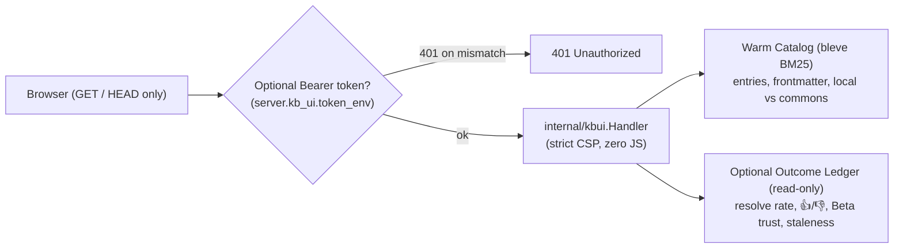

# Design — Live GCP CloudProvider verification & embedded read-only KB HTML explorer

- **Date:** 2026-11-24
- **Status:** Partially implemented (PR #629, merged 2026-11-24 — Track B & Track A capture harness merged; live GKE Standard capture pending)
- **Owner:** Smaine Kahlouch
- **Touches:**
  - Track A: `internal/providers/cloud/gcp/{live_capture_test.go,testdata/,auditlog.go,resourcehealth.go}`, `website/content/docs/integrations/data-sources/gcp-cloud.md`, `website/content/docs/concepts/design.md`, `website/content/docs/integrations/_index.md`, `README.md`
  - Track B: `internal/kbui/` (new), `internal/config/config.go`, `internal/server/server.go`, `internal/app/{kb_ui.go,kb_cmd.go,serve.go}`, `cmd/lore/main.go`, `website/content/docs/configuration/configuration.md`, `website/content/docs/security/security-model.md`, `website/content/docs/reference/cli.md`

## Problem

This design closes two independent operational & visibility gaps:

1. **Track A — GCP CloudProvider lenses remain fixture-only.** While `internal/providers/cloud/gcp` starts, authenticates via Workload Identity direct principal binding, and passes startup preflight on live GKE Standard 1.35.6 ([#562](https://github.com/Smana/runlore/issues/562)), its `cloud_what_changed` (Cloud Audit Logs `entries.list`) and `cloud_resource_health` (GKE Container API + Compute MIG/instances) parsers have only ever been tested against hand-written `httptest` JSON fixtures. Real GCP API quirks — specifically `protoPayload.status.code!=0` over absent status fields, real GKE `StatusCondition` fields, MIG `listErrors` shapes, and the negative-path IAM binding command printed on `403` — remain unverified.
2. **Track B — The compounding KB has no browser-readable view.** RunLore's central differentiator is its git-versioned, outcome-weighted OKF knowledge catalog. Today it can be queried via CLI (`lore kb search`/`show`) or MCP (`POST /mcp`), but SREs and platform leads have no lightweight browser view to search entries, inspect provenance, or see live outcome stats (resolve rate, 👍/👎 counts, Beta-posterior trust factor, staleness) without opening raw git files or JSONL ledgers.

## Decisions (locked during grilling)

| # | Decision | Choice | Rationale |
|---|---|---|---|
| **Q1** | Scope of the two tracks | **Ship both tracks cleanly decoupled**: (A) live GKE payload capture + captured `testdata/` fixtures + parser fixes, and (B) opt-in zero-dep embedded Go `html/template` read-only KB & outcome explorer (`/kb` on `lore serve` + local `lore kb serve`) | Track A retires an explicit honesty caveat on a shipped provider; Track B makes RunLore's compounding KB inspectable in a browser without adding any frontend build toolchain or external services. |
| **Q2** | Track A — GCP live bar | **Env-gated `TestGCPLiveCapture` + redacted `testdata/` fixtures; GKE Standard live capture closes Track A**, keeping tier-3 `node-provider-id` until a separate Autopilot run settles it | Follows `TestHybridRecallEvalLive`'s established env-gated live-verification precedent; lifts the "lenses unobserved" caveat honestly on captured Standard payloads without blocking on an Autopilot cluster or prematurely deleting tier-3 fallback. |
| **Q3** | Track B — Security & rendering | **New zero-dep `internal/kbui` package** using stdlib `html/template` + `embed.FS` + escape-first pure-Go markdown subset renderer (zero raw HTML passthrough, zero JS, zero external assets, strict CSP `default-src 'none'; style-src 'unsafe-inline'; base-uri 'none'; form-action 'self'`, `nosniff`, `X-Frame-Options: DENY`). Off by default (`server.kb_ui.enabled: false`), optional `server.kb_ui.token_env`, loopback-only `127.0.0.1:8081` default on `lore kb serve` | Preserves the single static Go binary, eliminates stored XSS from untrusted KB markdown via escape-first rendering + zero-JS CSP, and matches `server.mcp`'s exact opt-in auth and non-forwarded replica model. |

## Non-goals

- **Deleting GCP tier-3 `node-provider-id` fallback or its `nodes` RBAC grant in Track A.** Remains until an Autopilot cluster confirms `source=metadata-server`.
- **Write/edit/merge operations in the KB HTML explorer.** Strictly read-only (`GET`/`HEAD` only); edits continue to flow exclusively through Git PRs.
- **JavaScript SPA, external CSS/fonts, or third-party markdown/HTML-sanitizer dependencies.** Pure Go stdlib only.

---

## Track A: Live GCP CloudProvider verification

### 1. Env-gated capture test (`internal/providers/cloud/gcp/live_capture_test.go`)

Gated behind `RUNLORE_GCP_LIVE_CAPTURE=1` (skips cleanly in normal `go test ./...`):
- Reads `RUNLORE_GCP_PROJECT`, `RUNLORE_GCP_LOCATION`, `RUNLORE_GCP_CLUSTER` (and uses ADC — Workload Identity or `gcloud auth application-default login`).
- Makes read-only raw HTTP calls against the three real GCP endpoints:
  1. `logging.googleapis.com/v2/entries:list` — both unfiltered (`activity`/`system_event`) and failed-calls-only (`protoPayload.status.code!=0`, directly testing question #2 in `gcp-cloud.md`).
  2. `container.googleapis.com/v1/projects/.../locations/.../clusters/...` — cluster + node pools (directly testing `StatusCondition` fields, question #5).
  3. `compute.googleapis.com/compute/v1/...` — MIG `listErrors` + instances (directly testing question #3).
- Redacts sensitive identifiers deterministically (project ID/number → `proj-fixture`, email principals → `user@example.com`, cluster/node IPs → RFC 5737 `198.51.100.x`, request IDs/tokens) and writes sanitized JSON fixtures to `internal/providers/cloud/gcp/testdata/captured_*.json`.
- Also exercises the negative-path preflight check (against a deliberately unprivileged SA or recorded real `403` error body) to confirm the stderr `gcloud projects add-iam-policy-binding` command renders validly and passes shell syntax verification.

### 2. Captured-fixture regression suite & parser fixes

- Add hermetic unit tests loading `internal/providers/cloud/gcp/testdata/captured_*.json` through `auditlog.go` and `resourcehealth.go`, asserting every real field parses cleanly without silent drops.
- Fix any real-payload parser or filter discrepancies uncovered during capture (for example, if `protoPayload.status.code!=0` matches absent status fields differently than assumed).
- Update `website/content/docs/integrations/data-sources/gcp-cloud.md`, `website/content/docs/concepts/design.md`, `website/content/docs/integrations/_index.md`, and `README.md` to record the captured GKE Standard validation date/version and narrow any remaining caveat strictly to Autopilot.

---

## Track B: Embedded read-only KB HTML explorer (`internal/kbui`)

### 1. Routes & data view

Mounted at `/kb` on `lore serve` (when `server.kb_ui.enabled: true`) and at `/` + `/kb` on local `lore kb serve`:



| Route | Behavior |
|---|---|
| `GET /kb` (and `GET /kb/`) | Index & search page: HTML `<form method="GET">` with `?q=` (BM25 search via `Catalog.SearchScored`), `?type=` (`Incident\|Playbook\|Concept`), `?status=` (`active\|draft\|retired`), `?origin=` (`local\|commons`). Displays compact table: title, type badge, status badge, origin, resource/workload, `last_validated` + stale indicator, resolve rate (`k/n`), 👍/👎 counts, and Beta trust factor. |
| `GET /kb/entry/{path...}` | Single entry view: frontmatter metadata card, live outcome stats (when ledger is wired), provenance links (origin PR / applied resolutions if present), and rendered markdown body via escape-first safe markdown renderer. Returns `404` on unknown path or path traversal (`..`). |

### 2. Escape-first pure-Go markdown renderer (`internal/kbui/markdown.go`)

- Runs `html.EscapeString` **first** on every line (guaranteeing zero raw HTML injection from untrusted OKF entries), then transforms only a strict safe subset:
  - Fenced code blocks (` ``` `) → `<pre><code>...</code></pre>`
  - Headings (`#`–`####`) → `<h2 id="slug">...</h2>`..`<h5>` (slugs match `#resolution` anchors from Item 6!)
  - Unordered & ordered lists (`- `, `* `, `1. `) → `<ul>`/`<ol>` + `<li>`
  - Inline code (`` `...` ``), bold (`**...**`), and links (`[label](https://...)` — strictly `https://` scheme only; any other scheme renders as plain escaped text)
  - Paragraphs (`<p>...</p>`)
- Every response sets:
  - `Content-Type: text/html; charset=utf-8`
  - `Content-Security-Policy: default-src 'none'; style-src 'unsafe-inline'; base-uri 'none'; form-action 'self'; frame-ancestors 'none'`
  - `X-Content-Type-Options: nosniff`
  - `X-Frame-Options: DENY`
  - `Referrer-Policy: no-referrer`

### 3. Configuration, server wiring & CLI

- **Config (`config.ServerKBUI` under `server:`):**
  ```yaml
  server:
    kb_ui:
      enabled: false          # opt-in, off by default
      token_env: ""           # optional env var for Bearer auth; warns on serve if empty
  ```
- **Server (`internal/server/server.go`):**
  - Mounts `GET /kb`, `GET /kb/`, `GET /kb/entry/{path...}` directly on the replica (NOT leader-forwarded — mirrors `/mcp`, reads this replica's warm catalog + read-only ledger stats).
  - Returns `405 Method Not Allowed` for non-`GET`/`HEAD` requests.
  - Constant-time Bearer token check when `token_env` is configured; logs one startup `WARN` when enabled without `token_env` (mirroring `server.mcp.token_env`).
- **Local CLI (`lore kb serve`):**
  ```text
  lore kb serve [--config <path>] [--dir <catalog>] [--ledger <jsonl>] [--addr 127.0.0.1:8081]
  ```
  - Binds loopback `127.0.0.1:8081` by default (never `0.0.0.0` unless explicitly passed), loads catalog + optional outcome JSONL ledger read-only, and prints the local URL on stderr.

## Verification plan

- **Track A:**
  - Run `RUNLORE_GCP_LIVE_CAPTURE=1` against a live GKE Standard cluster to capture and commit redacted `testdata/captured_*.json` fixtures.
  - Verify hermetic `go test -race ./internal/providers/cloud/gcp/...` passes against all captured fixtures.
  - Update `gcp-cloud.md`, `design.md`, `integrations/_index.md`, and `README.md`.
- **Track B:**
  - Unit tests in `internal/kbui/markdown_test.go`: XSS payloads (`<script>`, ``, `[click](javascript:alert(1))`, `data:` URLs) are neutralized to inert escaped text; headings emit `#resolution` slugs; code blocks/lists/links render cleanly.
  - Unit tests in `internal/kbui/handler_test.go`: index search (`?q=`), type/status/origin filters, entry detail with outcome ledger stats + staleness badge, path traversal (`../secret`) returns 404, non-GET returns 405, Bearer token auth (constant-time, 401 on miss), strict CSP/security headers present on every response.
  - Server & CLI tests: `/kb` absent when `server.kb_ui.enabled == false`, mounted and unforwarded when `true`; `lore kb serve` binds cleanly and serves a fixture catalog + ledger.
- Full quality gate: `go build ./... && go vet ./... && go test ./... && gofmt -l . && hack/lint.sh`.
