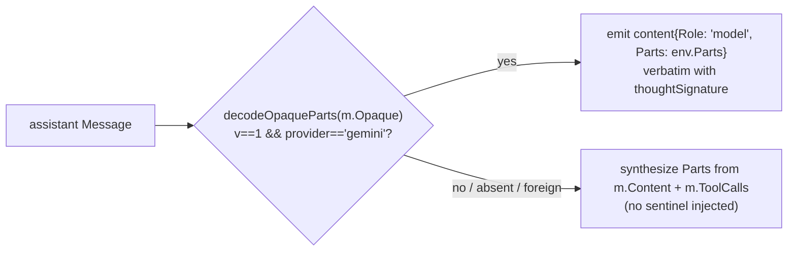

# Design — Gemini 3 & Gemini 4 support (`thoughtSignature` replay, `thinkingLevel`, and thinking-token billing)

- **Date:** 2026-11-24
- **Status:** Implemented (PR #627, merged 2026-11-24; closes #392)
- **Owner:** Smaine Kahlouch
- **Fixes:** [#392](https://github.com/Smana/runlore/issues/392)
- **Touches:** `internal/model/gemini/gemini.go`, `internal/model/gemini/gemini_test.go`, `internal/config/config.go`, `internal/config/config_test.go`, `internal/app/model.go`, `internal/app/model_test.go`, `internal/eval/compare.go`, `internal/eval/compare_test.go`, `website/content/docs/integrations/llm/gemini.md`, `website/content/docs/configuration/configuration.md`, `ROADMAP.md`

## Problem

RunLore's Gemini client (`internal/model/gemini`) works on Gemini 2.5 models, but fails on turn 2 of every multi-turn investigation on Gemini 3 and Gemini 4 (`gemini-4-neon`, `gemini-4-carbon`) with:

```text
400 INVALID_ARGUMENT: Function call is missing a thought_signature
```

Four related protocol gaps sit behind this failure:

1. **No `thoughtSignature` capture or replay.** Gemini 3 and Gemini 4 attach an opaque base64 `thoughtSignature` sibling field onto response `parts[]` (including the first `functionCall` part in a parallel tool-call turn, and text/thought parts). Replaying history without that signature causes a permanent `400` on the next request.
2. **No `thinkingConfig.thinkingLevel` control.** `config.Validate` rejects `model.effort` for `provider: gemini` solely because thought-signature replay was previously unimplemented. Gemini 4 Neon defaults to `high` and Carbon to `medium`; operators have no way to tune reasoning depth (`low`/`medium`/`high`/`xhigh`).
3. **Thinking tokens are under-counted.** Gemini reports `usageMetadata.thoughtsTokenCount` separately from `candidatesTokenCount` even though both bill at the output token rate. Today `accumulate` ignores `thoughtsTokenCount`, under-reporting `Usage.OutputTokens` against RunLore's token/cost ceilings and Prometheus metrics.
4. **No `thought: true` part filtering.** If a model or gateway emits `{"thought": true, "text": "..."}` reasoning summary parts, `accumulate` concatenates them into `CompletionResponse.Text`, leaking internal chain-of-thought into prose replies and fallback findings.

## Decisions (locked during grilling)

| # | Decision | Choice | Rationale |
|---|---|---|---|
| **Q1** | Target models & scope | **First-class Gemini 3 & Gemini 4 (`gemini-4-neon`, `gemini-4-carbon`)** alongside Gemini 2.5 | Gemini 4 Neon and Carbon are the primary current Gemini targets; they share the same REST `streamGenerateContent` `thoughtSignature` + `thinkingLevel` contract as Gemini 3. |
| **Q2** | Reasoning knob (`model.effort`) | **Unlock `model.effort` for `gemini` with `minimal\|low\|medium\|high\|xhigh`**, mapped uppercase to `generationConfig.thinkingConfig.thinkingLevel`; empty omits `thinkingConfig` | Mirrors `anthropic` (`output_config.effort`) and `openai` (`reasoning_effort`) so operators use one config knob. Omitting `thinkingConfig` when unset preserves each model's native default (`high` on Neon, `medium` on Carbon). Including `minimal` supports Gemini 3 Flash while letting Gemini 4 reject it with a permanent 400 (same pass-through tradeoff as Anthropic's `max`). `model.thinking` stays Anthropic-only (`"adaptive"`). |
| **Q3** | Replay state storage | **Versioned Gemini parts envelope in `providers.Message.Opaque`**: `{"v":1,"provider":"gemini","parts":[...]}` | Reuses the exact `Message.Opaque` seam already plumbed by `internal/investigate/loop.go:721` for Anthropic adaptive thinking, with zero changes to `providers.Message` or `providers.ToolCall`. Preserves part ordering, parallel-call first-part-only signatures, and signatures on non-`functionCall` parts, while keeping wire bytes deterministic for Gemini's implicit prefix cache. Version+provider tagging prevents misparsing foreign `Opaque` payloads (e.g. Anthropic's JSON array). |
| **Q4** | Thinking token accounting | **Fold `thoughtsTokenCount` into `Usage.OutputTokens`** (`candidatesTokenCount + thoughtsTokenCount`) | Matches Anthropic (`output_tokens`) and OpenAI (`completion_tokens`) billing semantics without widening `providers.Usage`. Ensures `max_tokens_per_investigation`, `max_cost_usd`, and telemetry reflect actual billed output tokens. |
| **Q5** | Thought-part filtering & missing-signature fallback | **Never send `includeThoughts: true`; exclude `thought: true` text from `out.Text`; drop unsigned `thought: true` parts from `Opaque`; no `skip_thought_signature_validator` sentinel on fallback** | Prevents chain-of-thought leakage and prompt bloat. Falling back cleanly to `Content` + `ToolCalls` without injecting a bypass sentinel fails loud on real history-plumbing bugs instead of masking them. |
| **Q6** | Output token defaults | **Keep uniform defaults (`8192` investigation, `1024` `model.chat`)** and document headroom in `gemini.md` | Consistent with Anthropic adaptive-thinking policy (`config.go:923`). Keeps `model.chat` cheap by default; operators configuring high/xhigh thinking on Gemini 4 raise `max_tokens` explicitly. |

## Non-goals

- **Switching to Google's Interactions API or adding the official Go GenAI SDK.** RunLore stays on raw `net/http` against `:streamGenerateContent?alt=sse` to preserve the single-binary, zero-SDK-sprawl rule.
- **Exposing `thinkingBudget` or `includeThoughts`.** Gemini 4 rejects legacy `thinkingBudget` with `400 INVALID_ARGUMENT`, and RunLore never renders internal chain-of-thought to end users.
- **Per-model pricing catalogs.** Cost ceilings remain operator-configured via `model.pricing`.
- **Adding `Opaque` to `internal/model/replay`.** Replay transcripts mock `ModelProvider` directly and never call the Gemini API.

## Wire contract & data flow

### Request (`Complete`)

```json
{
  "system_instruction": { "parts": [{ "text": "..." }] },
  "contents": [ ... ],
  "tools": [ ... ],
  "toolConfig": { "functionCallingConfig": { "mode": "ANY", "allowedFunctionNames": ["..."] } },
  "generationConfig": {
    "maxOutputTokens": 8192,
    "thinkingConfig": {
      "thinkingLevel": "HIGH"
    }
  }
}
```

- `generationConfig.thinkingConfig` is emitted **only** when `Client.effort != ""`, with `thinkingLevel: strings.ToUpper(c.effort)`. When `effort == ""`, `thinkingConfig` is omitted (`omitempty`) so byte-for-byte requests without `effort` are unchanged.
- Unlike Anthropic adaptive thinking, Gemini 3/4 permits `functionCallingConfig: {mode: "ANY"}` alongside `thinkingConfig` and still requires replaying prior `thoughtSignature`s on forced turns (such as the budget-nudge `submit_findings` call). Therefore `toContents` **always** replays `Message.Opaque` regardless of `req.ToolChoice`.

### Stream accumulation (`accumulate`)

Each `part` decoded from `candidates[0].content.parts[]` carries:

```go
type part struct {
	Text             string            `json:"text,omitempty"`
	Thought          bool              `json:"thought,omitempty"`
	ThoughtSignature string            `json:"thoughtSignature,omitempty"`
	FunctionCall     *functionCall     `json:"functionCall,omitempty"`
	FunctionResponse *functionResponse `json:"functionResponse,omitempty"`
}
```

Accumulation rules per incoming part `p`:

1. **Track signature presence:** if `p.ThoughtSignature != ""`, set `hasSignature = true`.
2. **`p.FunctionCall != nil`:**
   - Extract `id` (fall back to `p.FunctionCall.Name` when empty) and append `providers.ToolCall{ID: id, Name: p.FunctionCall.Name, Args: argString(p.FunctionCall.Args)}` to `out.ToolCalls`.
   - Append `part{FunctionCall: &functionCall{ID: wireID(id, p.FunctionCall.Name), Name: p.FunctionCall.Name, Args: clientcore.RawObject(argString(p.FunctionCall.Args))}, ThoughtSignature: p.ThoughtSignature}` to `replayParts`.
   - Crucially, `ThoughtSignature` stays attached **only** to the specific `functionCall` part that carried it (the first call in parallel function calling); sibling calls keep `ThoughtSignature: ""`.
3. **`p.Thought == true` (non-functionCall):**
   - Never append `p.Text` to `out.Text`.
   - If `p.ThoughtSignature != ""`, preserve `part{Text: p.Text, Thought: true, ThoughtSignature: p.ThoughtSignature}` in `replayParts`.
   - Otherwise drop it from `replayParts`.
4. **Plain text / trailing signature part (`p.FunctionCall == nil && !p.Thought`):**
   - If `p.Text != ""`, append `p.Text` to `out.Text`.
   - If `p.ThoughtSignature != ""`, append `part{Text: p.Text, ThoughtSignature: p.ThoughtSignature}` to `replayParts` (even when `p.Text == ""`).
   - Else if `p.Text != ""`, coalesce into the previous `replayParts` entry when that entry is also an unsigned, non-thought plain text part (`prev.FunctionCall == nil && !prev.Thought && prev.ThoughtSignature == ""`); otherwise append `part{Text: p.Text}`.
5. **Usage metadata:**
   - `out.Usage.OutputTokens = gr.UsageMetadata.CandidatesTokenCount + gr.UsageMetadata.ThoughtsTokenCount`.
6. **Opaque emission:**
   - If `hasSignature && len(replayParts) > 0`, marshal `opaqueEnvelope{Version: 1, Provider: "gemini", Parts: replayParts}` into `out.Opaque`.
   - When no `thoughtSignature` appeared in the response (e.g. Gemini 2.5 without signatures), `out.Opaque` remains `nil`, preserving zero overhead and exact legacy behavior.

### Replay (`toContents`)



- `idToName` continues to index `m.ToolCalls` across all messages (and defensively indexes any `FunctionCall` inside decoded `Opaque` parts if `m.ToolCalls` is empty), so coalesced `tool` turns (`functionResponse`) correlate identically by `ID` or `Name`.
- **Implicit prefix cache stability:** `opaqueEnvelope` and `part` contain only structs and slices (no map iteration), and `clientcore.RawObject` keeps JSON args deterministic, so `toContents` emits byte-identical prefixes across turns (`TestRequestPrefixStable`).
- **History compaction:** `internal/investigate/loop.go` compacts old turns into plain text user/assistant summary messages (no `ToolCalls`, no `Opaque`) while keeping recent tail turns intact with their `Opaque`. Both halves serialize validly without touching `loop.go`.

## Config, wiring & documentation changes

1. **`internal/config/config.go`:**
   - Add `"gemini": {"minimal": true, "low": true, "medium": true, "high": true, "xhigh": true}` to `effortLevels`.
   - Remove the `if provider == "gemini"` early return in `validateEffort`.
   - Update doc comments on `Model.Effort` and `effortLevels`.
2. **`internal/app/model.go`:**
   - Pass `effort` to `gemini.New(baseURL, model, apiKey, maxTokens, effort)`.
   - Update doc comment on `NewModelClient`.
3. **`internal/eval/compare.go`:**
   - Update comment on `ValidateEffort` (it already calls `config.ValidateEffort`, so wiring works automatically).
4. **Docs:**
   - `website/content/docs/integrations/llm/gemini.md`: replace "Gemini 3.x does not work" with Gemini 2.5 / Gemini 3 / Gemini 4 (`gemini-4-neon`, `gemini-4-carbon`) guidance, `model.effort` table, and `max_tokens` headroom note (including `model.chat.max_tokens` when using Neon/Carbon).
   - `website/content/docs/configuration/configuration.md`: add `gemini` to the `model.effort` list.
   - `ROADMAP.md`: mark #392 closed once implemented.

## Verification plan

Unit tests (TDD, hermetic `httptest`):
- Single `functionCall` with `thoughtSignature` captured into `Opaque` and replayed verbatim on turn 2.
- Parallel `functionCall` turn where only the first call carries `thoughtSignature`: signature preserved on first part only, never duplicated onto sibling parts, both `functionResponse`s correlated.
- Trailing empty-text part carrying `thoughtSignature` preserved in `Opaque`; adjacent unsigned text deltas coalesced into one part.
- `thought: true` parts excluded from `out.Text`; unsigned `thought: true` dropped from `Opaque`; signed `thought: true` retained in `Opaque`.
- Foreign/malformed `Opaque` (e.g. Anthropic JSON array `[{"type":"thinking",...}]`) safely ignored with clean fallback to `Content` + `ToolCalls` and no sentinel injected.
- Forced `ToolChoice` (`Mode: "ANY"`) still replays prior turns' `Opaque` signatures and sends `thinkingConfig` when `effort` is configured.
- `usageMetadata.thoughtsTokenCount` summed into `out.Usage.OutputTokens`.
- `TestRequestPrefixStable` extended with a signed multi-turn `Opaque` conversation confirming byte-identical prefixes.
- `config.Validate` & `eval.LoadCompareConfig` accept `minimal|low|medium|high|xhigh` on `gemini` (including `verify`/`chat` inheritance) and reject invalid values (`max`, `auto`, etc.).
- Quality gate: `go build ./... && go vet ./... && go test ./... && gofmt -l . && hack/lint.sh`.
