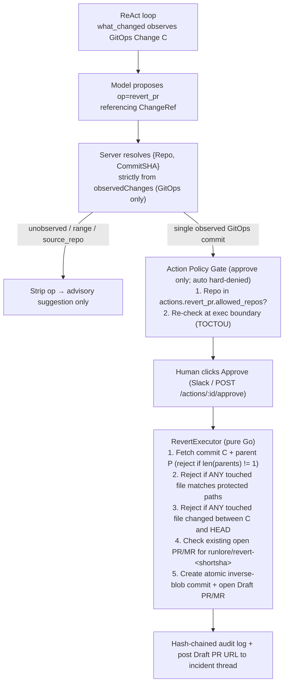

# Design — Native deterministic Git-revert PR action (`revert_pr`)

- **Date:** 2026-11-24
- **Status:** Approved (grilling complete)
- **Owner:** Smaine Kahlouch
- **Depends on:** Item 6 (`internal/investigate/observedchanges.go` server-side observed GitOps changes)
- **Touches:** `internal/providers/providers.go`, `internal/config/config.go`, `internal/action/{safety.go,policy.go,auto.go,approvals.go}`, `internal/executor/revertpr/` (new), `internal/forge/{github,gitlab}/`, `internal/investigate/{loop.go,tools.go,observedchanges.go}`, `internal/app/{action.go,serve.go}`, `website/content/docs/concepts/design.md`, `website/content/docs/security/security-architecture.md`

## Problem

RunLore deliberately rejected in-cluster GitOps rollbacks ([design.md §6](file:///home/smana/Sources/runlore/website/content/docs/concepts/design.md#L279-L298)) because patching a `GitRepository` inside `flux-system` violates protected-namespace boundaries and causes cluster drift against Git. That same decision identified the GitOps-correct remediation primitive: a **reviewed Git-revert PR** that stays in sync with Git and is inherently reversible.

Today, teams running RunLore without an external agent factory only get read-only text suggestions in Slack ("revert commit `abc123`") or the three cluster-level Flux/Argo ops (`suspend`, `resume`, `reconcile`). When `what_changed` identifies a single recent GitOps commit as the verified root cause, an operator still has to manually locate the repo, check out a branch, run `git revert`, push, and open a PR at 03:00.

## Decisions (locked during grilling)

| # | Decision | Choice | Rationale |
|---|---|---|---|
| **Q1** | Trigger & approval gate | **New `revert_pr` op on `actions.mode: approve`, hard-blocked from `auto`**: operator clicks Approve in Slack/API to open a **Draft** revert PR/MR, then reviews and merges on GitHub/GitLab | Two-step safety: no unattended Git write on a sub-50% RCA baseline, and the resulting Draft PR never mutates the cluster until a human merges it. Fits the existing `internal/action` approval queue and hash-chained `internal/audit` log cleanly. |
| **Q2** | Revert mechanics | **Pure-Go deterministic revert (no `git` binary)**: accepts only a single non-merge commit `C` (1 parent `P`) whose touched files have no newer commits on `HEAD`, restoring each file to its parent blob in one atomic commit on `runlore/revert-<shortsha>`; fails closed on merge commits or overlapping later edits | Preserves RunLore's single static binary and minimal container image, eliminates subprocess attack surface, and refuses heuristic 3-way merges that could silently corrupt manifests. |
| **Q3** | Credential separation | **Dedicated optional credential block under `actions.revert_pr`** (separate GitHub App / GitLab token env scoped to allowlisted GitOps repos), with explicit `reuse_forge_credentials: true` opt-in; empty `allowed_repos` fails closed | Prevents accidentally coupling low-privilege KB markdown write tokens to high-privilege GitOps repo write rights unless the operator opts in explicitly. |
| **Q4** | Repo scope, protected paths & forge parity | **GitOps repos only** (never `source_repos`); reject the entire commit if **any** touched file matches built-in protected paths (`flux-system`, `kube-system`, `.github/`, `.gitlab-ci.yml`) or operator `protected_paths`; implement **both GitHub and GitLab** in v1 with idempotent open-PR/MR dedup per commit SHA | Reverting an application `source_repo` does not roll back a cluster until CI rebuilds and GitOps bumps the tag; rejecting any commit touching a protected path mirrors `builtinProtectedNamespaces`; idempotent dedup prevents branch/PR spam on retries. |

## Non-goals

- **Auto-merging revert PRs or running `revert_pr` under `actions.mode: auto`.** Permanently forbidden; human merge on the forge is always required.
- **LLM-generated manifest edits or 3-way merge conflict resolution.** This op is strictly a deterministic inverse of one clean commit — never synthesized YAML.
- **Reverting application `source_repos` or multi-commit ranges.** Out of scope; a multi-commit range is surfaced as a suggestion only.
- **Shelling out to `git`.** Zero external binary dependencies.

## Safety envelope & architecture



### 1. Canonical op registry (`internal/providers/providers.go` & `internal/action`)

Extend `providers.OpSafety` with `ApproveOnly bool`:

```go
var Ops = map[string]OpSafety{
	"suspend":   {Reversible: true, Blast: 1},
	"resume":    {Reversible: true, Blast: 1},
	"reconcile": {Reversible: true, Blast: 1},
	"revert_pr": {Reversible: true, Blast: 2, ApproveOnly: true},
}
```

- `internal/action/auto.go` hard-denies any op with `ApproveOnly == true` (cannot be overridden by config).
- `providers.Action` adds a server-populated (never model-authored!) `Revert *RevertTarget` struct:
  ```go
  type RevertTarget struct {
      Repo      string `json:"repo"`       // normalized owner/repo or group/subgroup/project
      RepoURL   string `json:"repo_url"`   // normalized https:// repo URL
      CommitSHA string `json:"commit_sha"` // full 40-char observed GitOps commit SHA
      Branch    string `json:"branch,omitempty"` // default branch resolved at execution time
  }
  ```
- During `loop.go` post-processing, if a proposed action carries `Op == "revert_pr"`, the server looks up `CommitSHA` + `RepoURL` exclusively from `observedChanges` (recorded by `what_changed`, never `source_diff`). If the commit is unobserved, spans multiple commits without a single causal SHA, or targets a `source_repo`, the server **strips `Op`** so it degrades cleanly to a read-only suggestion.
- At both `Policy.Review` and `Approvals.Approve` (TOCTOU re-validation), `Policy` enforces:
  - `actions.revert_pr.enabled == true`
  - `a.Revert != nil && a.Revert.CommitSHA != ""`
  - `a.Revert.Repo` is in `actions.revert_pr.allowed_repos` (empty list permits nothing).

### 2. Configuration (`internal/config/config.go`)

```yaml
actions:
  mode: approve
  revert_pr:
    enabled: false                    # explicit opt-in; off by default
    allowed_repos: []                 # required when enabled (e.g. ["org/gitops-infra"])
    protected_paths: []               # extra glob patterns appended to built-in deny list
    reuse_forge_credentials: false    # explicit opt-in to reuse top-level forge.* credentials
    forge:                            # dedicated credentials (required unless reuse_forge_credentials: true)
      provider: github                # github | gitlab
      github_app: { app_id: ..., installation_id: ..., private_key_ref: ... }
      gitlab: { url: ..., token_env: ... }
```

- Built-in protected path rules (always enforced, never shrinkable):
  - Any path segment equal to `flux-system` or `kube-system`
  - `.github/**`
  - `.gitlab-ci.yml` or `.gitlab/**`
- Startup `Validate()` fails closed if `actions.revert_pr.enabled == true` and any of: `actions.mode != approve`, `len(allowed_repos) == 0`, or neither `actions.revert_pr.forge` nor `reuse_forge_credentials: true` (with a valid top-level `forge`) is configured.

### 3. Pure-Go revert execution (`internal/executor/revertpr` + `internal/forge/{github,gitlab}`)

Define a focused `providers.RevertForge` interface implemented by both `internal/forge/github` and `internal/forge/gitlab`:

```go
type CommitDetail struct {
	SHA        string
	Parents    []string
	Message    string
	Files      []CommitFile // Path, Status ("added"|"modified"|"removed"|"renamed"), PreviousPath
}

type RevertForge interface {
	DefaultBranch(ctx context.Context, repo string) (branch, headSHA string, err error)
	CommitDetail(ctx context.Context, repo, sha string) (CommitDetail, error)
	CompareChangedFiles(ctx context.Context, repo, baseSHA, headSHA string) ([]string, error)
	FileBlob(ctx context.Context, repo, ref, path string) ([]byte, bool, error)
	FindOpenPRByHead(ctx context.Context, repo, headBranch string) (url string, number int, found bool, err error)
	CreateRevertDraftPR(ctx context.Context, req RevertPRRequest) (url string, number int, err error)
}
```

Execution algorithm (`RevertExecutor.Execute`):
1. Resolve default branch + current `headSHA`.
2. Check idempotency: if an open PR/MR already exists for branch `runlore/revert-<sha[:12]>`, return its URL cleanly (audited as `reused_existing_pr`).
3. Fetch `CommitDetail(repo, sha)`:
   - Reject if `len(Parents) != 1` (merge commit or root commit).
   - Reject if `len(Files) == 0` or `len(Files) > 50` (safety cap on blast radius).
   - Reject if **any** `Path` or `PreviousPath` matches built-in or operator `protected_paths`.
4. Check clean-head invariant: if `sha != headSHA`, call `CompareChangedFiles(repo, sha, headSHA)`. If **any** file in `CommitDetail.Files` (including `PreviousPath` on renames) appears in the subsequent diff, **fail closed** with an explicit conflict message naming the overlapping file(s).
5. Materialize parent state for each file in `CommitDetail.Files`:
   - `added` → delete `Path`
   - `modified` / `removed` → restore exact bytes from `FileBlob(repo, parentSHA, Path)`
   - `renamed` → delete `Path` and restore exact bytes from `FileBlob(repo, parentSHA, PreviousPath)`
6. Create branch `runlore/revert-<sha[:12]>` from `headSHA`, write one atomic commit (`Revert "<first line of C>"\n\nThis reverts commit <sha>.`), and open a **Draft** PR (GitHub `draft: true`) / **Draft** MR (GitLab `Draft: ` title prefix) whose body includes the redacted incident summary, evidence trail, provenance link to `C`, and audit entry ID.
7. Record full outcome (opened PR URL or refusal reason) in `internal/audit` and post the Draft PR URL back into the incident thread.

## Verification plan

- Unit tests in `internal/action/`: `revert_pr` hard-denied under `auto`; allowed under `approve` only with `allowed_repos` match + server-derived `RevertTarget`; TOCTOU re-checked at `Approve()`.
- Unit tests in `internal/executor/revertpr/`:
  - Clean revert of added, modified, removed, and renamed files (exact parent bytes restored).
  - Refuses merge commit (`len(Parents) == 2`), root commit (`len(Parents) == 0`), >50 files.
  - Refuses any commit touching `flux-system`, `kube-system`, `.github/workflows/ci.yaml`, `.gitlab-ci.yml`, or custom `protected_paths` (even if other files in the commit are allowed).
  - Refuses overlapping subsequent commit between `C` and `HEAD`.
  - Idempotency: returns existing open PR URL without creating duplicate branches.
- `httptest` fixture tests in `internal/forge/github/` and `internal/forge/gitlab/` for `RevertForge` methods (atomic GitHub Git Data API tree+commit + Draft PR; GitLab Repository Commits API batch actions + Draft MR).
- Config validation tests for dedicated credentials vs `reuse_forge_credentials: true` and fail-closed `allowed_repos`.
- Update `website/content/docs/concepts/design.md` §6 and `website/content/docs/security/security-architecture.md` §1.
- Full quality gate: `go build ./... && go vet ./... && go test ./... && gofmt -l . && hack/lint.sh`.
