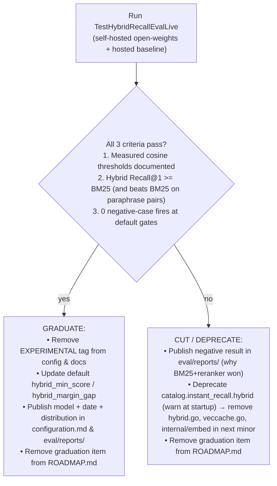

# Design — Hybrid recall graduation (or cut), replay eval corpus expansion, and `#394`

- **Date:** 2026-11-24
- **Status:** Partially implemented (PR #633, merged 2026-11-24 — #394, hybrid eval wiring, and 17-case corpus merged; live embedding benchmark pending)
- **Owner:** Smaine Kahlouch
- **Fixes:** [#394](https://github.com/Smana/runlore/issues/394)
- **Touches:** `internal/eval/{eval.go,compare_run.go,compare_report.go,replay_report.go}`, `internal/investigate/hybrideval_test.go`, `internal/config/config.go`, `internal/catalog/hybrid.go`, `examples/eval/*.yaml`, `examples/eval/fixtures/`, `website/content/docs/configuration/configuration.md`, `ROADMAP.md`

## Problem

Three gaps currently weaken RunLore's evaluation and retrieval trust story:

1. **Hybrid recall is stuck in unmeasured `EXPERIMENTAL` limbo.** `internal/catalog/hybrid.go`, `veccache.go`, and `internal/embed` are implemented and maintained, yet `hybrid_min_score` (0.80) and `hybrid_margin_gap` (0.05) remain unmeasured placeholders. Worse, `internal/eval` never wires `model.embeddings` / `hybrid`, so `lore eval` cannot measure hybrid recall end-to-end, and the existing retrieval eval has no paraphrase/lexical-mismatch cases where embeddings actually have a chance to beat BM25.
2. **Thin replay corpus (`examples/eval/` has 7 cases).** Key cloud-native failure modes already represented in `eval/scenarios/` (DNS resolution, Cilium/network policy drop, PVC unbound, cert expiry, Argo CD degraded, AWS/GCP cloud control-plane changes, correlation-only inconclusive traps, and paraphrase recall) have no hermetic replay cases, limiting regression coverage and model-comparison signal.
3. **Vacuous columns in `lore eval --compare` ([#394](https://github.com/Smana/runlore/issues/394)).** When cases lack `ground_truth`, `--compare` still publishes empty/zero judge and source-coverage columns that look like measured zeros rather than unmeasured (`N/A`) metrics.

## Decisions (locked during grilling)

| # | Decision | Choice | Rationale |
|---|---|---|---|
| **Q1** | Hybrid recall fate (pass-or-cut gate) | **Wire hybrid recall into `lore eval`, add lexical-mismatch/paraphrase fixtures, run `TestHybridRecallEvalLive` — graduate if criteria 1–3 pass, or deprecate/remove hybrid if BM25+reranker matches/beats it** | Prevents unmeasured `EXPERIMENTAL` code from lingering indefinitely. Graduation happens strictly on measured numbers, never vibes; if embeddings add no lift over BM25+reranker, deleting the subsystem simplifies RunLore. |
| **Q2** | Reference embedding baselines | **Benchmark one self-hosted open-weights model** (vLLM/Ollama, e.g. `bge-m3` or `nomic-embed-text`) **plus one hosted baseline** (`text-embedding-3-small` or `gemini-embedding-001`) | Aligns with RunLore's self-hosted sovereignty ICP while testing whether shipped cosine defaults (`hybrid_min_score`, `hybrid_margin_gap`) transfer across embedding models or must be documented as model-dependent. |
| **Q3** | Eval corpus expansion & `#394` | **Expand `examples/eval/` from 7 to ~16–18 hermetic replay cases** (including ≥ 2 held-out cases) **and close `#394`** (omit/mark `—` vacuous `ground_truth` columns in `--compare`) | Gives statistically meaningful coverage across failure domains, tests hybrid vs BM25 on genuine lexical-mismatch scenarios, and ensures published comparison reports never misrepresent unmeasured columns as `0%`. |

## Non-goals

- **Approximate Nearest Neighbour (ANN) indexes.** Exact in-RAM cosine scan stays fast well past 1,000 entries (matches `ROADMAP.md` non-goals).
- **Retuning investigation prompts against held-out cases.** Held-out cases are explicitly labelled and must never be used to iterate on `systemPrompt`.
- **Adding live-cluster dependencies to `examples/eval/`.** Every new case in `examples/eval/` stays 100% hermetic YAML replay.

## Detailed design

### 1. Close `#394` — honest `--compare` columns

In `internal/eval/compare_run.go` and `internal/eval/compare_report.go`:
- Track `HasGroundTruth bool` (or `JudgedCount int`, `CoverageCount int`) per row/run alongside the existing aggregates.
- In `compare_report.go`:
  - If **zero** cases in the suite carry `ground_truth` (or `Judge == nil`), **omit** the `Judge` / `Coverage` columns entirely from the rendered markdown/table and print a single footnote: `Judge & source-coverage columns omitted (no cases carry ground_truth).`
  - If **some** cases carry `ground_truth` (mixed suite), render `score (k/N)` showing the exact denominator `k` of judged cases, or `—` when `k == 0` for a cell — never `0.0%`.
  - Keep JSON output explicit with `judged_cases` / `coverage_cases` counts alongside nullable/pointer rates so downstream tools never confuse `0` with unmeasured.

### 2. Wire hybrid recall into `internal/eval`

- In `internal/eval/eval.go`: when the eval config enables `catalog.instant_recall.hybrid` and `model.embeddings`, build the embedder via `embed.New(...)` (or inject an `Embedder` in tests), attach it to the per-case catalog via `cat.SetEmbedder(...)`, and wire `recall.Hybrid = cat`, `recall.HybridMinScore`, `recall.HybridMarginGap`.
- Record embedding token usage into `eval.Result.Usage` (matching `loop.go` spend accounting).
- Add a hermetic unit test confirming `lore eval` runs hybrid recall end-to-end against a fake `Embedder` and records recall outcomes (`RecallFired`, `RecallShortCircuit`).

### 3. Expand `examples/eval/` (7 → 17 cases) & paraphrase retrieval fixtures

Existing 7 cases remain untouched. Add **10 new hermetic replay cases** (keeping fixtures compact to bound nightly CI token spend):

| # | New replay case | Failure class | Purpose |
|---|---|---|---|
| 1 | `dns-coredns-servfail.yaml` | No-change / DNS | CoreDNS upstream timeout & `kube_events`/`pod_logs` correlation |
| 2 | `network-cilium-policy-drop.yaml` | Network | Cilium Hubble policy drop blocking service-to-service traffic |
| 3 | `pvc-storageclass-unbound.yaml` | Storage | Unbound PVC / missing StorageClass (`FailedScheduling` / `Pending`) |
| 4 | `cert-manager-expiry.yaml` | Certificates | Expired TLS cert / failing ACME challenge |
| 5 | `argocd-degraded-sync.yaml` | GitOps (Argo CD) | Exercises Argo CD `gitops_resource_status` + `gitops_tree` + diff |
| 6 | `aws-cloudtrail-sg-change.yaml` | Cloud control plane | Out-of-band AWS SecurityGroup edit via `cloud_what_changed` |
| 7 | `correlation-only-inconclusive.yaml` | Honesty / anti-hallucination | Unrelated recent deploy + unrelated symptom → must NOT blame the deploy; low confidence / `unresolved` |
| 8 | `recall-paraphrase-oom.yaml` | Lexical-mismatch recall | Alert worded differently from KB entry ("container killed due to RAM ceiling" vs "OOMKilled exit 137") — tests hybrid vs BM25 |
| 9 | `recall-paraphrase-dns.yaml` | Lexical-mismatch recall | Synonym alert wording vs stored DNS runbook — tests hybrid vs BM25 |
| 10 | `heldout-statefulset-wal-lock.yaml` | **Held-out** (second held-out case) | Multi-signal StatefulSet crash not tuned against prompts |

Also add 4–6 matching lexical-mismatch positive pairs and 2 hard-negative near-miss pairs to `internal/investigate/hybrideval_test.go` so `TestHybridRecallEvalLive` directly compares **BM25-only**, **BM25 + LLM reranker**, and **Hybrid (BM25 + embeddings)** on the same corpus.

### 4. Pass-or-cut graduation gate (live benchmark decision tree)

- **Nightly CI spend note:** With 17 cases, review `.github/workflows/eval.yaml`'s `-n` repetition count (e.g. `-n 3` vs `-n 5`) against `eval/ci.runlore.yaml` pricing so nightly CI cost stays within target budget.

## Verification plan

- Unit tests in `internal/eval/compare_report_test.go` & `compare_run_test.go` pinning `#394`: zero-`ground_truth` suite omits judge/coverage columns; mixed suite prints explicit `k/N` denominator and `—` for `0/0`.
- Unit tests in `internal/eval/eval_test.go` exercising hybrid recall wiring with a deterministic fake embedder.
- Validate all 17 YAML replay cases load cleanly (`TestExamplesEvalCasesLoad` / `lore eval` dry validation).
- Run `TestHybridRecallEvalLive` against self-hosted + hosted embedding models, commit the dated report under `eval/reports/`, and execute either the **Graduate** or **Cut** branch.
- Full quality gate: `go build ./... && go vet ./... && go test ./... && gofmt -l . && hack/lint.sh`.
